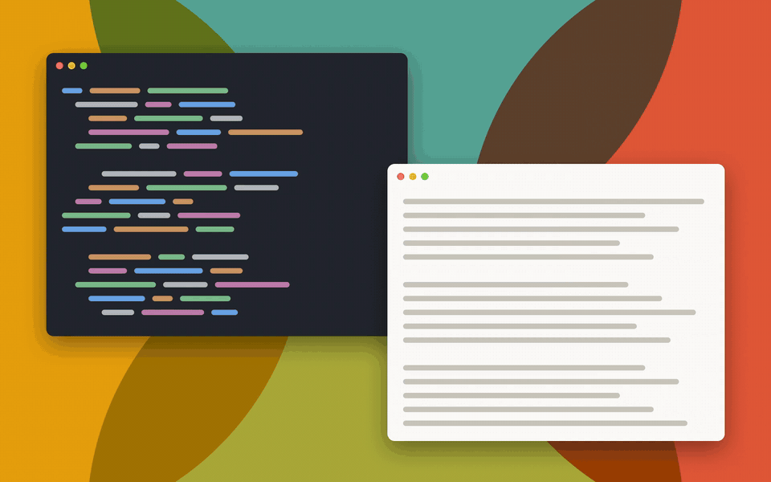
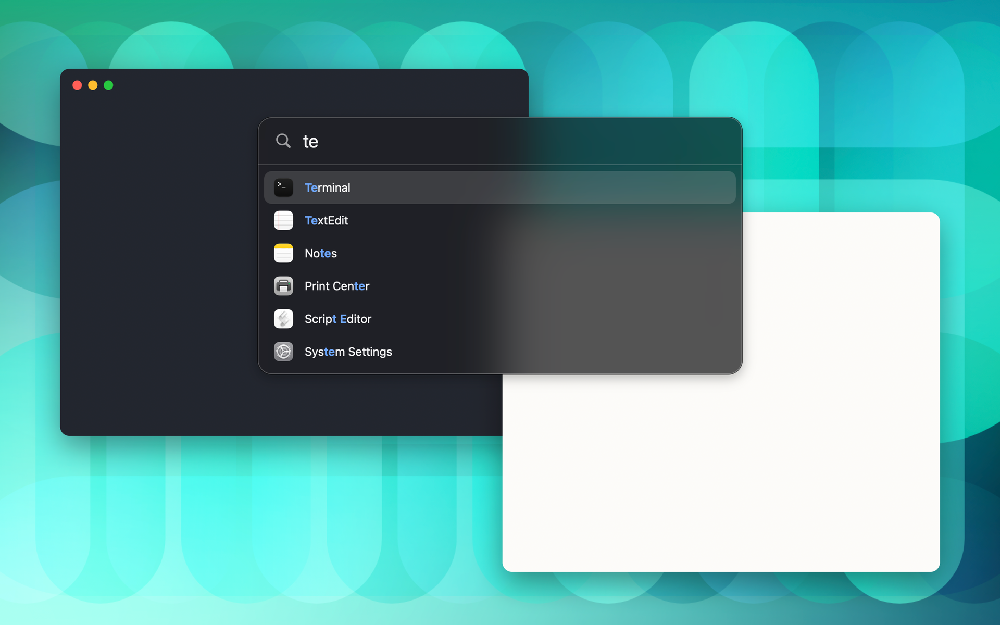
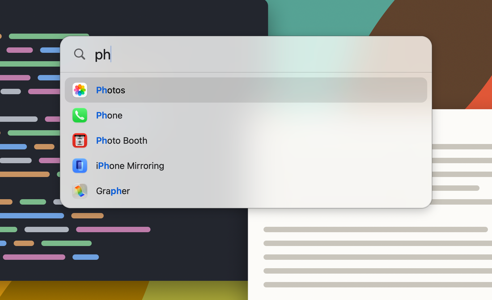
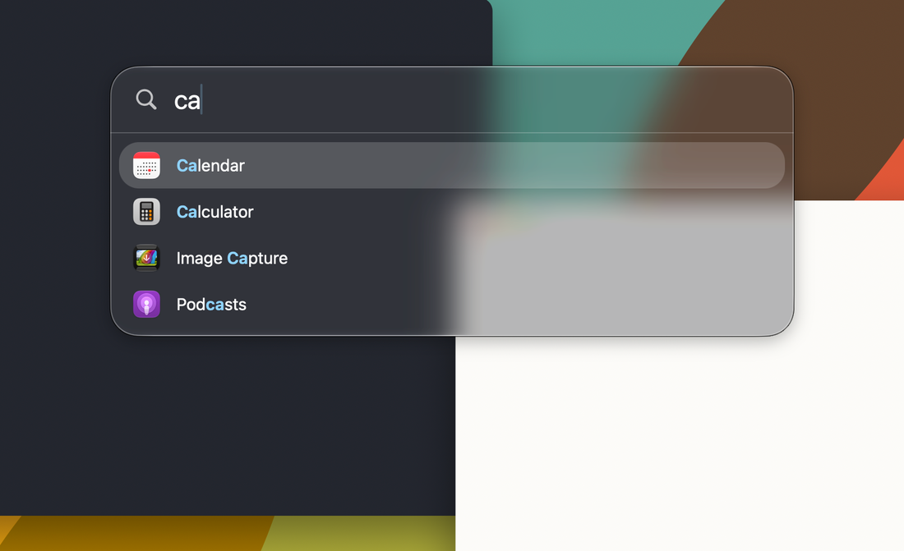
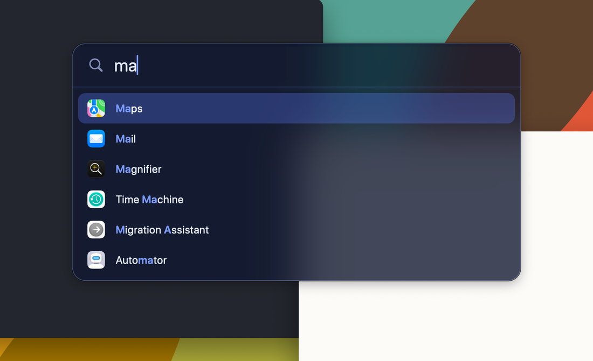
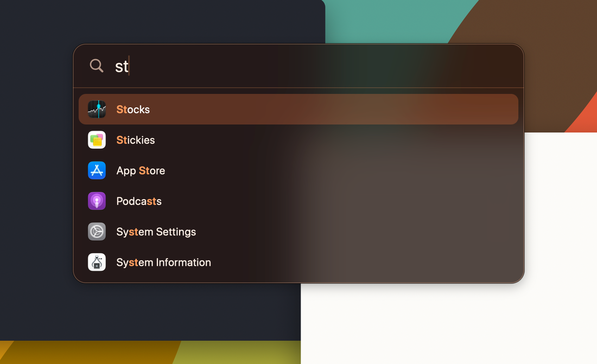
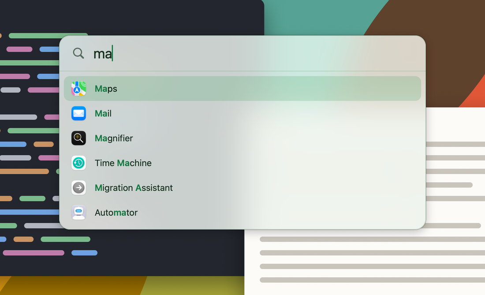
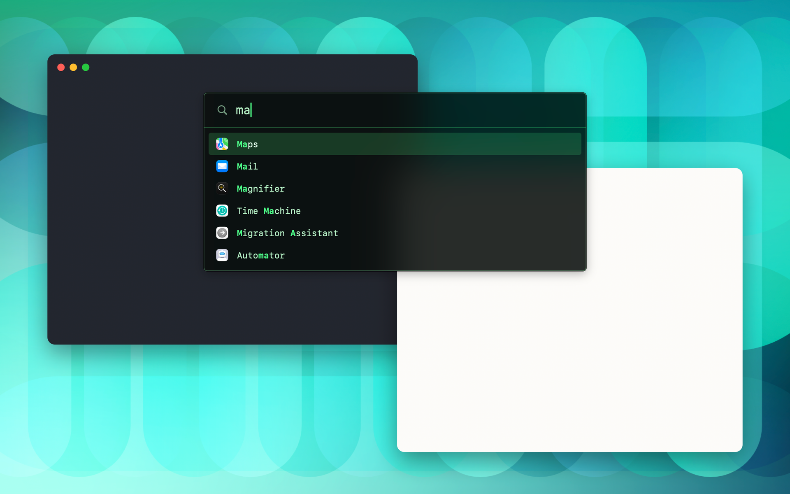
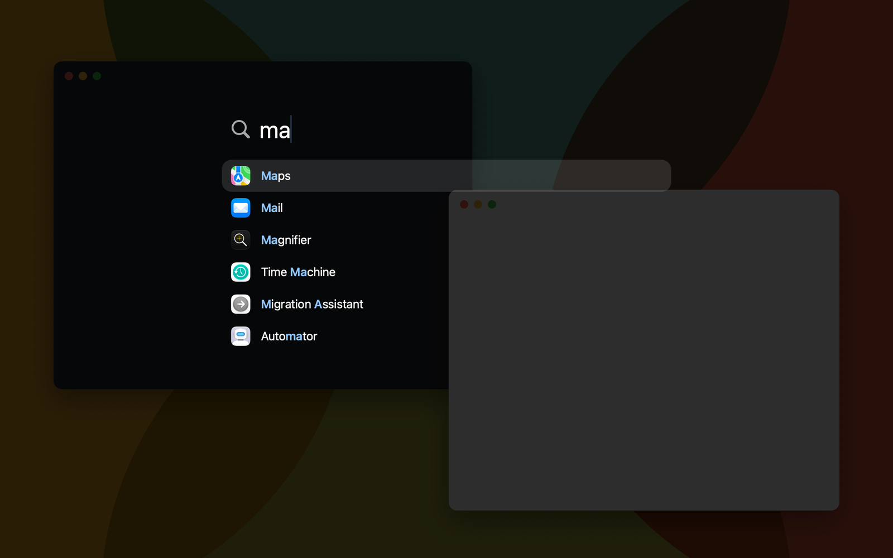
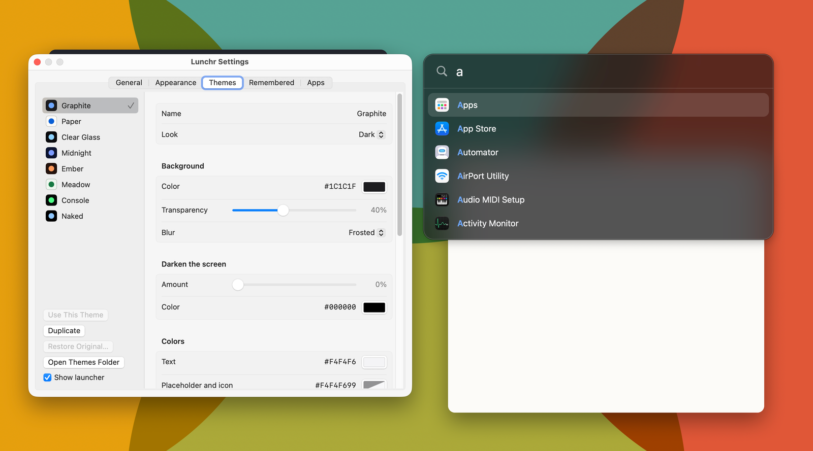

# Lunchr

Opens apps. Nothing else. Ok, with themes, but nothing else.

(Also, no telemetry... literally just opens apps)

Enjoy!



[Full quality video](docs/media/lunchr.mp4)

## Requirements

- macOS 14 or later
- Xcode 26 or later, opened once to finish its setup

## Install

1. Build it, copy it to /Applications and start it:

   ```sh
   git clone https://github.com/adrianjean/lunchr.git
   cd lunchr
   ./build.sh install
   ```

2. Press ⌥Space.

To use ⌘Space instead:

1. Turn off System Settings › Keyboard › Keyboard Shortcuts › Spotlight › Show Spotlight search.
2. Click Lunchr Settings › General › Use ⌘Space instead.

## Keys

| Key | |
|---|---|
| ↑ ↓ / Tab | move |
| ↩ | open (and remember it for this search) |
| ⌘↩ | open and pin it to this search |
| ⌘H | hide the app from results |
| ⌘, | Settings |
| esc | close |

Right-click a result to pin, unpin or hide it.

## Order

1. Pinned for this search
2. Last picked for this search
3. Full name typed
4. Pinned or picked for a longer or shorter version of this search (2+ letters)
5. Match: start of name, start of a word, initials, middle of a word. Most used first inside each.

Loose matches only show when nothing better does.

## Themes


| | |
|---|---|
|  Graphite |  Paper |
|  Clear Glass |  Midnight |
|  Ember |  Meadow |
|  Console |  Naked: no panel, only a darkened screen |



Settings › Themes: edit colors, transparency, blur, darkening, font and sizes with the launcher beside it. Saved as you go. Restore Original brings a built-in back; Duplicate makes your own.

Or put a `.json` in `~/Library/Application Support/Lunchr/Themes`. Changes show on save. Every field is optional:

| Field | Values |
|---|---|
| `name`, `dark` | text, true/false |
| `background`, `text`, `secondaryText`, `accent`, `selection`, `selectedText`, `border` | `#RRGGBB` or `#RRGGBBAA` |
| `opacity` | 0 (only blur) to 1 (solid) |
| `blur` | `none` `soft` `frosted` `heavy` `glass` (glass needs macOS 26) |
| `dim`, `dimColor` | how much the screen darkens, 0 to 1, and `#RRGGBB` |
| `font` | `system` `rounded` `mono` `serif` or a font family |
| `cornerRadius`, `querySize`, `rowSize`, `iconSize`, `width` | points |

A file named after a built-in (`graphite.json`) replaces it.

## Reveal

Settings › Appearance › Reveal: Off, Pop, or Pop and glow (default; the glow is the theme's `accent`, or white on light themes). With Reduce Motion on it only fades.

Settings › Appearance › Darken the screen: each theme's own (only Naked darkens), or the same color and amount for every theme. Covers the screen the launcher opens on, menu bar and Dock included.

## License

[PolyForm Noncommercial 1.0.0](LICENSE.md): use, copy and change it for any noncommercial purpose, and keep the copyright notice with every copy. No commercial use.
